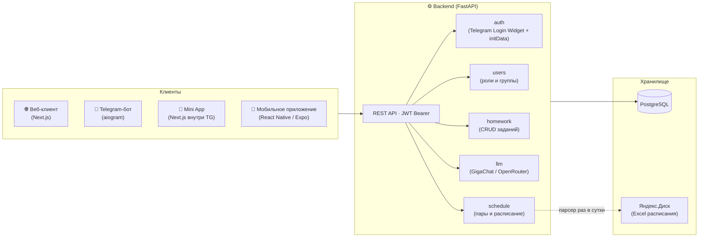
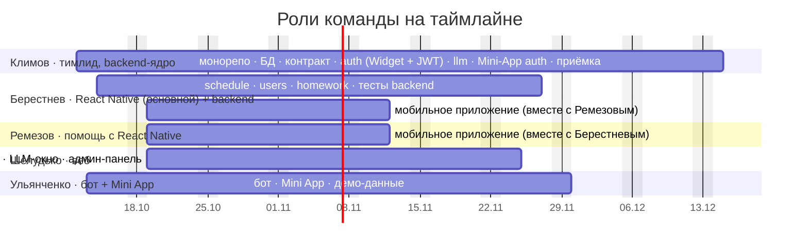

# Дорожная карта Zeta · MVP

> Графическая версия с интерактивной диаграммой Ганта и детализацией задач: [`Roadmap.html`](Roadmap.html).

---

## 📅 Таймлайн разработки

```mermaid
gantt
    title Zeta MVP · План разработки по пакетам
    dateFormat YYYY-MM-DD
    axisFormat %d.%m
    excludes weekends

    section 🚀 Инфраструктура
    Монорепо и CI                :crit, i1, 2026-10-12, 8d
    БД: PostgreSQL, Alembic      :crit, i2, 2026-10-13, 1d
    OpenAPI-контракт и моки API  :crit, i3, 2026-10-14, 3d

    section ⚙️ Backend
    schedule · Excel             :b2, 2026-10-14, 8d
    auth · Widget + JWT          :crit, b1, 2026-10-19, 8d
    users · роли                 :crit, b3, 2026-10-29, 6d
    homework · CRUD              :crit, b4, 2026-11-06, 8d

    section 🧠 LLM
    llm · GigaChat/OpenRouter    :l1, 2026-10-29, 9d

    section 🌐 Веб
    Авторизация (виджет)         :w1, 2026-10-19, 5d
    Календарь / канбан           :w2, 2026-10-26, 9d
    Форма ДЗ                     :w4, 2026-11-06, 5d
    LLM-окно (звёздочка)         :w5, 2026-11-13, 3d
    Админ-панель                 :w3, 2026-11-18, 6d

    section 🤖 Telegram-бот
    BotFather, long polling      :t1, 2026-10-13, 4d
    /start и онбординг           :t2, 2026-10-19, 3d
    ДЗ текстом + вопросы         :t3, 2026-10-22, 6d

    section 📱 Мобильное (RN)
    Структура и навигация        :m1, 2026-10-19, 3d
    Вход в мобилке               :m2, 2026-10-22, 4d
    Просмотр расписания и ДЗ     :m3, 2026-10-28, 7d
    Создание ДЗ старостой        :m4, 2026-11-06, 5d

    section 💬 Mini App
    Mini App: расписание и ДЗ    :a1, 2026-11-06, 5d
    auth · вход Mini App (initData) :crit, a2, 2026-11-11, 3d

    section 🧪 Тесты и сборка
    Unit/e2e-тесты backend       :crit, ts1, 2026-11-18, 6d
    Интеграционная сборка        :crit, ts2, 2026-11-18, 6d
    MVP собран                   :milestone, m_mvp, 2026-11-25, 0d
    Демо-данные                  :ts3, 2026-11-26, 3d
    Ручное тестирование и фиксы  :crit, ts4, 2026-12-01, 4d
    Приёмочные материалы         :ts5, 2026-12-07, 8d
    Приёмка на паре              :milestone, m_final, 2026-12-16, 0d
```

---

## 🎯 Архитектурные слои MVP



---

## 🗺️ Карта поставок по направлениям

```mermaid
flowchart LR
    subgraph S1["Этап 1 · Фаза 4"]
        direction TB
        I["🚀 Инфраструктура<br/>монорепо · БД · контракт API"]
    end

    subgraph S2["Итерация 1 · 12.10–25.10"]
        direction TB
        M1["⚙️ Backend<br/>auth · users · schedule · homework"]
        M2["🌐 Веб<br/>календарь · форма ДЗ · админ-панель"]
        M3["🤖 Telegram-бот<br/>ДЗ текстом · вопросы"]
        M4["💬 Mini App<br/>расписание · ДЗ · подгруппа"]
        M5["📱 Мобильное приложение<br/>вход · просмотр · создание ДЗ"]
        M6["🧠 LLM<br/>GigaChat / OpenRouter"]
    end

    subgraph S3["Итерация 2 · 26.10–08.11"]
        direction TB
        INT["🧪 Интеграция<br/>сборка клиентов с API · e2e"]
    end

    subgraph S4["Итерация 3 · 09.11–22.11"]
        direction TB
        MVP(("🔵 MVP собран<br/>25.11.2026"))
    end

    subgraph S5["Итерация 4 · 23.11–06.12"]
        direction TB
        QA["🛠️ Стабилизация<br/>ручное тестирование · баг-фиксы"]
    end

    subgraph S6["Сдача · 07.12–16.12"]
        direction TB
        REL(("🏁 Приёмка<br/>16.12.2026"))
    end

    S1 --> S2 --> S3 --> S4 --> S5 --> S6
```



---

## 👥 Распределение ролей в команде



| Участник | Роль | Зона |
|---|---|---|
| **Иван Климов** | Тимлид, backend-ядро | монорепо и CI, БД (Alembic), OpenAPI-контракт, сквозная авторизация (`auth` backend, валидация Telegram Login Widget, вход Mini App), `llm`, приёмка + ревью и помощь везде |
| **Берестнев Алексей** | React Native (основной), backend | мобильное приложение (вместе с Ремезовым), `schedule`, `users`, `homework`, тесты backend |
| **Ремезов Никита** | Помощь с React Native | только мобильное приложение, вместе с Берестневым; отдельная вспомогательная роль — все мобильные задачи назначаются им обоим |
| **Шелудько Данил** | Веб-фронтенд | экран авторизации (Telegram Login Widget), календарь/канбан, форма ДЗ, LLM-окно, админ-панель |
| **Ульянченко Даниил** | Telegram-бот, Mini App | весь бот, Mini App, демо-данные |

---

## ⚠️ Риски дорожной карты

Порядок урезания функций при отставании от графика:

1. **`7.4` Создание/редактирование ДЗ в мобильном приложении** (Should) — староста может использовать веб.
2. **`5.5` Окно LLM-ввода ДЗ в вебе** (Should) — остаётся стандартная форма ввода ДЗ.
3. **`6.3` Ввод ДЗ текстом через Telegram-бота** (Should) — староста вносит через веб-форму.
4. **`5.4` Админ-панель** (Must) — в крайнем случае управление через скрипты миграций.
