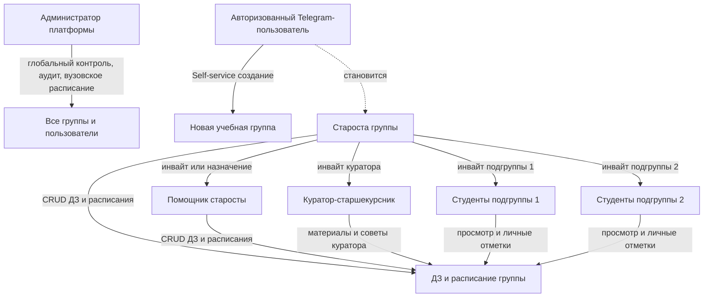
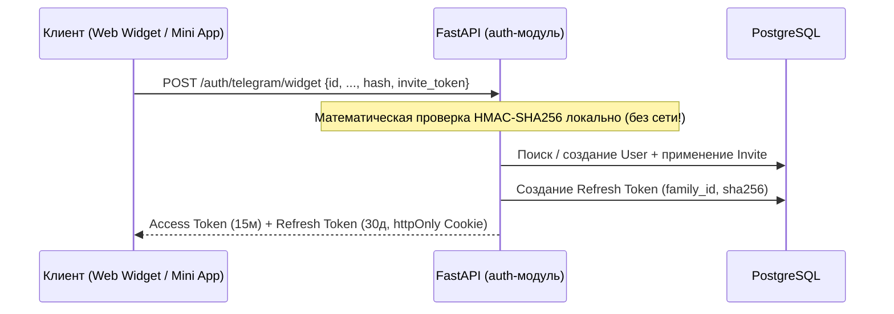
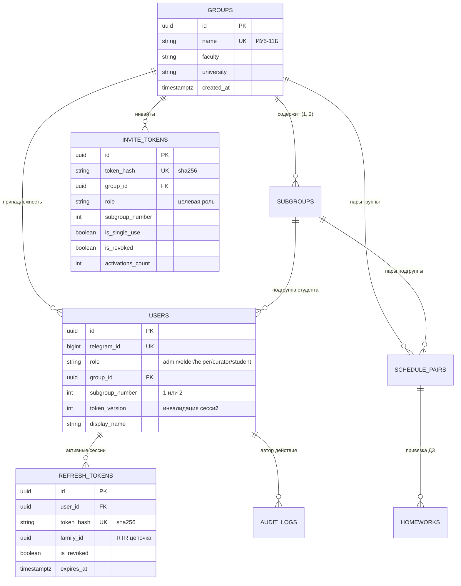
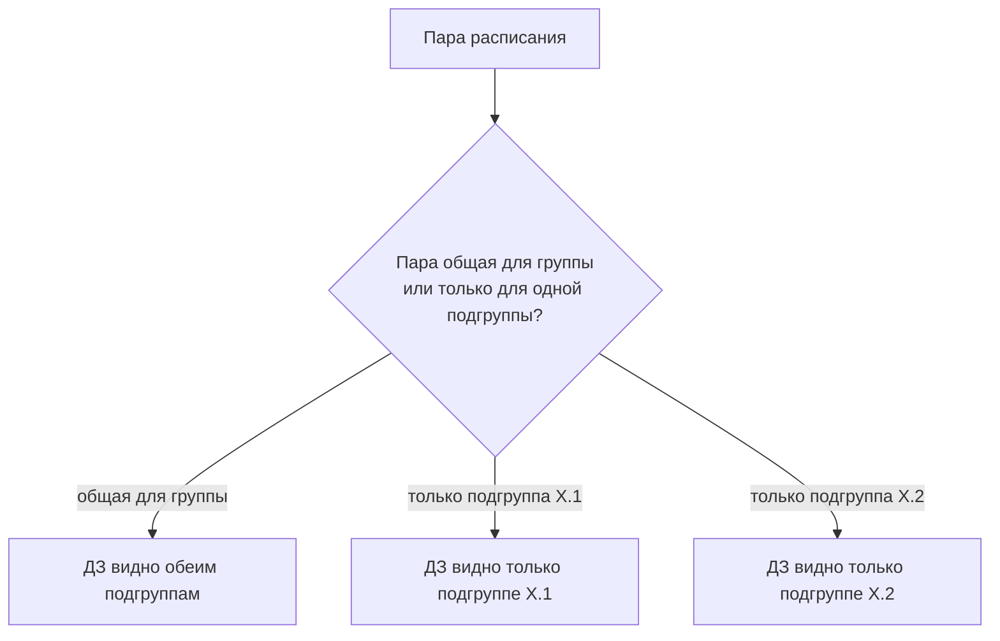

# Техническое задание
## Система учёта домашних заданий студентов ФКН

**Версия:** 0.7
**Дата:** 01.11.2026
**Автор:** Иван Климов
**Статус:** согласовано, актуализировано

---

## 1. Общее описание

Система представляет собой открытую, модульную платформу с набором клиентов — веб-приложение на Next.js, мобильное приложение на React Native и Telegram-бот с Telegram Mini App — работающих поверх общего асинхронного бэкенда на FastAPI и единой базы данных PostgreSQL. Назначение системы — централизованный сбор, хранение и структурированный просмотр домашних заданий (ДЗ) студентов. Система привязывает ДЗ к конкретным парам расписания с учётом группы, подгруппы и чередования числителя/знаменателя, что позволяет студенту всегда видеть, что задано на ближайшие занятия, а старостам и их помощникам — быстро вносить задания через форму, мобильное приложение или текстом через бота.

### Независимая и Open-Source архитектура (Community-Driven)
Zeta спроектирована как открытое независимое решение, применимое как для централизованного факультетского развёртывания, так и для автономной работы любых студенческих групп любого вуза:
1. **Self-Service создание групп:** любой студент может зарегистрировать свою группу самостоятельно, не дожидаясь действий общевузовского суперпользователя, и получить статус старосты (`elder`).
2. **Взаимопомощь студентов (Peer-to-Peer):** в систему заложена поддержка ролей помощников старосты (`helper`) и старшекурсников-наставников (`curator`), помогающих младшим курсам материалами, лабами и советами.
3. **Гибкость источников расписания:** система поддерживает как централизованную фоновую синхронизацию с вузовским Excel/ICS-расписанием (например, с Яндекс.Диска или сайта факультета), так и локальный импорт файла расписания на уровне конкретной группы её старостой/хелпером либо ручной ввод пар.

Целевая аудитория — студенты, старосты и кураторы. Система не предназначена для преподавателей и не выполняет функции электронного журнала: она не хранит оценки, не отслеживает посещаемость и не является официальным источником учебной информации.

## 2. Пользователи и роли

В системе действует иерархическая ролевая модель на основе RBAC (Role-Based Access Control):

- **Суперпользователь (`admin`)** — глобальный системный администратор платформы. Имеет полный доступ ко всем группам и пользователям, просмотру журнала безопасности (`audit_log`), ручной загрузке общевузовских расписаний и принудительной модерации любых учётных записей.
- **Староста (`elder`)** — создатель или назначенный руководитель группы. Обладает полным контролем над группой:
  - генерирует и отзывает инвайт-ссылки для подгрупп, хелперов и кураторов;
  - может передать роль старосты любому студенту группы;
  - управляет составом хелперов группы;
  - выполняет полный CRUD расписания и домашних заданий группы;
  - может импортировать локальный файл расписания группы.
- **Помощник старосты (`helper`)** — студент данной группы, наделённый правами со-управления:
  - создание, редактирование и удаление домашних заданий обеих подгрупп;
  - корректировка расписания группы (переносы пар, отмены, обновление ссылок);
  - не может удалить группу, отозвать старосту или передать владение группой.
- **Куратор (`curator`)** — студент старшего курса или официальный наставник, прикреплённый к группе:
  - просмотр расписания и домашних заданий подопечной группы;
  - публикация учебных материалов от куратора (методички, полезные ссылки на репозитории/диски, подсказки к лабораторным работам);
  - контакт куратора отображается студентам в карточке группы для оперативной связи;
  - не имеет права редактировать официальные домашние задания от преподавателей.
- **Студент (`student`)** — рядовой участник группы, закреплённый за конкретной подгруппой (1 или 2):
  - просмотр расписания и домашних заданий своей подгруппы и общих пар группы;
  - персональная отметка «Выполнено» для личного трекинга;
  - сдача/занесение ДЗ боту свободным текстом (с последующей отправкой старосте на валидацию);
  - редактирование своих профильных данных (отображаемое имя).

### Матрица прав доступа (Permissions Matrix)

| Действие / Ресурс | Студент (`student`) | Куратор (`curator`) | Помощник (`helper`) | Староста (`elder`) | Админ (`admin`) |
|---|:---:|:---:|:---:|:---:|:---:|
| Просмотр расписания и ДЗ группы | ✅ (своя подгруппа) | ✅ (все подгруппы) | ✅ (все подгруппы) | ✅ (все подгруппы) | ✅ (любая группа) |
| Личные отметки «Выполнено» | ✅ | ✅ | ✅ | ✅ | — |
| CRUD ДЗ своей группы | ❌ | ❌ | ✅ | ✅ | ✅ |
| Корректировка расписания группы | ❌ | ❌ | ✅ | ✅ | ✅ |
| Загрузка локального расписания группы | ❌ | ❌ | ❌ | ✅ | ✅ |
| Генерация/отзыв инвайт-ссылок группы | ❌ | ❌ | ❌ | ✅ | ✅ |
| Назначение/снятие роли `helper` | ❌ | ❌ | ❌ | ✅ | ✅ |
| Передача роли `elder` другому студенту | ❌ | ❌ | ❌ | ✅ | ✅ |
| Публикация материалов куратора | ❌ | ✅ | ❌ | ✅ | ✅ |
| Глобальный аудит и бан пользователей | ❌ | ❌ | ❌ | ❌ | ✅ |



---

## 3. Онбординг и авторизация

### 3.1 Модель доступа и сквозная идентификация

Идентичность пользователя строится вокруг **`telegram_id` — это единый первичный ключ аккаунта** во всей экосистеме Zeta (веб, бот, Mini App, мобильное приложение). Логины и пароли отсутствуют по построению.

Система работает в полузакрытом режиме:
1. **Любой авторизованный через Telegram пользователь** может войти в систему. Если у него ещё нет группы, он попадает на приветственный экран с возможностью:
   - Нажать **«Создать группу»** (Self-service): ввести название (например, `ИУ5-11Б`), вуз/факультет и стать старостой (`elder`) созданной группы.
   - Либо перейти по инвайт-ссылке, полученной от старосты своей группы/подгруппы.
2. **Вход по инвайт-ссылке:** мгновенно привязывает пользователя к соответствующей группе и подгруппе, а также выставляет роль (`student`, `helper`, `curator`).

### 3.2 Инвайты и управление доступом

#### Ссылка старосты (Централизованный бутстрап)
Для сценария централизованного внедрения факультетом администратор может сгенерировать персональную одноразовую ссылку на роль старосты:
- `POST /auth/invites/elder` с телом `{"group_name": "ИУ5-11Б"}`.
- Создаётся одноразовый криптостойкий токен (`secrets.token_urlsafe(32)`).
- При переходе староста входит через Telegram Login Widget; система находит или создаёт группу `ИУ5-11Б`, назначает пользователя `elder`, токен сжигается (`is_revoked = True`).

#### Инвайт-ссылки группы (Управление старостой)
Староста в панели управления группой имеет доступ к генерации и отзыву ссылок:
1. **Инвайт подгруппы 1 (`student`, подгруппа 1):** многоразовая бессрочная ссылка для чата первой подгруппы.
2. **Инвайт подгруппы 2 (`student`, подгруппа 2):** многоразовая бессрочная ссылка для чата второй подгруппы.
3. **Инвайт помощника (`helper`):** ссылка для назначения активиста или заместителя группы.
4. **Инвайт куратора (`curator`):** ссылка для закрепления куратора со старшего курса.

#### Отзыв ссылок при компрометации
Если ссылка случайно попала в публичный чат, староста в один клик нажимает «Отозвать ссылку» (`DELETE /auth/invites/{id}`). Запись в БД помечается `is_revoked = True`, и любой последующий переход по старой ссылке отклоняется с ошибкой `400 Bad Request`. Староста тут же генерирует новую ссылку.

#### Схема таблицы `invite_tokens` в PostgreSQL:
- `id`: UUID, первичный ключ.
- `token_hash`: `VARCHAR(64)` — SHA-256 от переданного токена (сырой токен в базе не хранится).
- `group_id`: UUID, внешний ключ на `groups` (nullable для bootstrap-ссылок админа с `group_name`).
- `group_name`: `VARCHAR(64)` (строка для бутстрапа до создания группы).
- `role`: `VARCHAR(32)` — целевая роль (`student`, `helper`, `curator`, `elder`).
- `subgroup_number`: `INT` (1 или 2, nullable для куратора/старосты).
- `is_single_use`: `BOOLEAN` (`True` для старосты, `False` для подгрупп).
- `is_revoked`: `BOOLEAN` (флаг отзыва).
- `activations_count`: `INT` (счётчик успешных регистраций по ссылке).
- `created_by_user_id`: UUID создателя ссылки.
- `created_at`: `TIMESTAMPTZ`.

---

### 3.3 Защита сессий, JWT и механизм отзыва токенов

Для обеспечения безопасности и предотвращения кражи сессий в Zeta заложена трёхуровневая архитектура токенов:

```
[ Клиент ] 
    │ (Access Token: 15 минут, stateless, bearer)
    │ (Refresh Token: 30 дней, httpOnly Secure Cookie / Keychain)
    ▼
[ POST /auth/refresh ] ──► Проверка token_hash в таблице refresh_tokens
                              │
                              ├─► Токен валиден и активен? 
                              │     └── RTR: старый токен revoke, выдать новый в том же family_id
                              │
                              └─► Токен УЖЕ отозван? (REUSE DETECTION)
                                    └── 🚨 Взлом/повтор! Немедленный отзыв всей семьи (family_id)
                                        и инкремент users.token_version
```

#### Времена жизни:
- **Access Token:** 15 минут. Подписан алгоритмом EdDSA (Ed25519) или HS256. Содержит клеймы: `sub` (`user_id`), `role`, `gid` (`group_id`), `subgroup`, `tv` (`token_version`). Валидируется сервисами локально без походов в базу.
- **Refresh Token:** 30 дней. Строго криптографическая случайная последовательность высокой энтропии. Хранится в веб-клиенте исключительно в `httpOnly`, `Secure`, `SameSite=Lax` cookies, в мобильном клиенте — в защищённом хранилище (Keychain/Keystore).

#### Схема таблицы `refresh_tokens` в PostgreSQL:
Сырые токены в БД **никогда не сохраняются**. При компрометации дампа БД злоумышленник не может выпустить сессии.
- `id`: UUID.
- `user_id`: FK на `users.id` (ON DELETE CASCADE).
- `token_hash`: `VARCHAR(64)` — `sha256(raw_refresh_token)` с уникальным индексом.
- `family_id`: UUID цепочки сессии конкретного браузера/устройства.
- `is_revoked`: `BOOLEAN DEFAULT FALSE`.
- `expires_at`: `TIMESTAMPTZ`.
- `created_at`: `TIMESTAMPTZ DEFAULT now()`.
- `user_agent`: `TEXT` (метаданные для аудита).
- `ip_address`: `INET` (IP-адрес клиента).

#### Механизм Refresh Token Rotation (RTR):
Каждый refresh-токен является **строго одноразовым**. При штатном запросе `POST /auth/refresh`:
1. В транзакции с `SELECT ... FOR UPDATE` находится запись по `sha256(raw_token)`.
2. Если `is_revoked == False` и срок действия не истёк:
   - Старый токен помечается `is_revoked = True`;
   - Выпускается новый refresh-токен с **тем же `family_id`**;
   - Клиенту отдаются новый refresh-токен и свежий 15-минутный access-токен.

#### Обнаружение повторного использования (Reuse Detection):
Если на эндпоинт `POST /auth/refresh` поступает токен, у которого в БД **`is_revoked == True`**, это означает попытку повторного использования скомпрометированного токена (например, перехваченный ранее злоумышленником токен после того, как легитимный студент уже обновил сессию, либо наоборот).

**Реакция системы при Reuse Detection:**
1. Немедленно отзывается **вся семья токенов** с этим `family_id`:
   ```sql
   UPDATE refresh_tokens SET is_revoked = TRUE WHERE family_id = :compromised_family_id;
   ```
2. Инкрементируется глобальная версия токенов пользователя `users.token_version += 1`.
3. В журнал `audit_log` записывается инцидент `SECURITY_ALERT_REFRESH_REUSE`.
4. Клиент получает `401 Unauthorized` и принудительно разлогинивается на всех устройствах.

#### Мгновенный отзыв короткоживущих Access JWT (`token_version`):
Для сценариев бана пользователя, смены роли старосты или аварийного сброса сессий в таблицу `users` добавлено поле `token_version: INT DEFAULT 1`.
- При вызове `POST /auth/logout` или принудительном сбросе сессий выполняется `token_version += 1`.
- При любых критических операциях (редактирование ДЗ, управление ролями) бэкенд сверяет клейм `"tv"` из JWT с текущим значением в БД/кэше. При расхождении запрос отклоняется с кодом 401, не дожидаясь истечения 15 минут.

---

### 3.4 Технический флоу входа (Telegram Login Widget и Mini App)

#### 1. Вход в веб через Telegram Login Widget
1. На странице `/login` (или `/invite/<token>`) отображается кнопка Telegram Login Widget.
2. Пользователь подтверждает вход $\rightarrow$ Telegram возвращает клиенту объект: `id` (`telegram_id`), `first_name`, `last_name`, `username`, `photo_url`, `auth_date`, `hash`.
3. Фронтенд передаёт эти поля на `POST /auth/telegram/widget` (с `invite_token`, если вход по ссылке).
4. FastAPI валидирует HMAC без обращения к серверам Telegram:
   - `data_check_string` — поля кроме `hash` и `invite_token`, отсортированные по алфавиту в виде `key=value\n`;
   - `secret_key = SHA256(bot_token)`;
   - Проверка: `HMAC_SHA256(secret_key, data_check_string) == hash`;
   - Проверка: `auth_date` не старше 24 часов (защита от replay attack).
5. Пользователь находится в БД или создаётся новый (с применением параметров инвайта).
6. Выдаётся пара JWT (access + refresh в httpOnly cookie).

#### 2. Вход через Telegram Mini App
1. Пользователь нажимает кнопку бота «Открыть приложение» $\rightarrow$ открывается Next.js WebView.
2. Telegram автоматически предоставляет `Telegram.WebApp.initData` (строка с полями и HMAC-подписью).
3. Фронтенд вызывает `POST /auth/telegram/webapp` с телом `{"init_data": "..."}`.
4. FastAPI валидирует подпись:
   - `secret_key = HMAC_SHA256(key="WebAppData", msg=bot_token)`;
   - `HMAC_SHA256(secret_key, data_check_string) == hash`.
5. По `telegram_id` выдаётся аналогичная пара JWT.



---

### 3.5 Сетевая архитектура и проксирование

Важное разграничение сетевых контуров системы:
1. **Модуль `auth` (FastAPI) НЕ ТРЕБУЕТ ПРОКСИ:**
   - Валидация подписей Telegram Login Widget и Telegram Mini App выполняется исключительно математически на стороне бэкенда при помощи ключа `bot_token`.
   - В процессе авторизации бэкенд **не делает ни одного сетевого вызова** к серверам Telegram. Авторизация работает мгновенно и со 100% надёжностью на любом российском сервере без VPN и прокси.
2. **Сервис `telegram-bot` ТРЕБУЕТ ПРОКСИ:**
   - Процесс бота взаимодействует с внешним HTTP API Telegram (`https://api.telegram.org/bot<TOKEN>/...`) через long polling (`getUpdates`) и отправку сообщений.
   - Для обхода возможных сетевых сбоев и блокировок в процессе `telegram-bot/` настраивается HTTPS/SOCKS5-прокси (через Cloudflare Tunnel / Anycast или защищённый egress-прокси).

---

## 4. Источник расписания

Расписание в Zeta имеет двухуровневую структуру, поддерживающую как централизованный вузовский источник, так и автономное ведение группами.

### 4.1 Уровень 1: Общевузовское расписание (Централизованный импорт)
Берётся из Excel-файла факультета (Яндекс.Диск или локальная загрузка администратором).
Файл содержит листы:
- «Расписание (бак., спец.)» — основное расписание бакалавриата и специалитета;
- «Расписание (маг.)» — магистратура;
- «Расписание (заочное)» — заочная форма, сессии;
- «Распределение дней» — распределение дней по курсам и формам;
- «Календарь» — календарь семестра с чередованием числителя и знаменателя.

Из файла извлекаются:
- день недели, номер и время пары;
- курс, направление, профиль или специализация;
- группа и подгруппа;
- название предмета и тип пары (лекция, семинар, лабораторная);
- ФИО преподавателя, аудитория, корпус;
- служебные пометки (ДО, ВУЦ, ФК, ВК, НИР).

### 4.2 Уровень 2: Автономное расписание группы (Self-Service)
Для независимых групп, групп других факультетов или при задержке публикации официального файла:
- Староста (`elder`) или администратор может загрузить файл расписания своей группы (`.xlsx` или `.ics` / iCalendar) через интерфейс: `POST /schedule/groups/{group_id}/import`.
- Староста и его помощники (`helper`) могут добавлять и корректировать пары непосредственно через веб-календарь (перенос пары на другую дату/аудиторию, отмена пары, добавление факультатива).

### 4.3 Схема данных сущностей



---

## 5. Домашние задания

ДЗ создают и редактируют старосты (`elder`) и их помощники (`helper`). Каждое ДЗ привязано к конкретной паре расписания. Если пара общая для всей группы, ДЗ отображается обеим подгруппам; если пара относится только к одной подгруппе, ДЗ видит только она.

Поля ДЗ:
- привязка к паре расписания;
- описание задания (Markdown-разметка поддерживается);
- вложения (файлы; голосовые сообщения не поддерживаются);
- автор создания/правки (`created_by_user_id`, `updated_by_user_id`).

Студенты группы видят ДЗ своей подгруппы с возможностью переключения фильтра на другую подгруппу. Кураторы видят ДЗ обеих подгрупп и могут прикреплять дополнительные комментарии-материалы для студентов.



### 5.1 Хранение вложений (отложено)
Хранение бинарных файлов-вложений абстрагировано интерфейсом `FileStorage` (методы `upload`, `get`, `delete`). Для MVP вложения отложены (§11); в последующих версиях подключается S3-совместимое хранилище (MinIO / Selectel).

---

## 6. Интерфейс

Основной экран — интерактивный календарь на день или неделю с визуализацией пар и привязанных к ним заданий.
- **Веб-интерфейс (Next.js):**
  - Таблица расписания по дням с цветовой индикацией числителя/знаменателя;
  - Карточки пар с домашними заданиями;
  - Кнопка-«звёздочка» для быстрого ввода ДЗ текстом с обработкой LLM;
  - Панель управления группой для старосты: список студентов, генерация и отзыв инвайт-ссылок, назначение хелперов, выгрузка данных.
- **Telegram Mini App (Next.js роут):**
  - Оптимизирован под мобильный экран Telegram WebView: свайпы по дням недели, быстрый просмотр ДЗ, переключение подгруппы.

---

## 7. Telegram-бот и Mini App

У Telegram-присутствия два взаимосвязанных интерфейса:
- **Нативный чат бота:** текстовые команды, приём ДЗ текстом с валидацией через LLM, ответы на типовые вопросы («что задано на завтра»).
- **Telegram Mini App:** полноценный веб-интерфейс внутри Telegram с мгновенным входом по `initData`.

### 7.1 Флоу занесения ДЗ через чат
1. Староста или хелпер пишет боту: *«ДЗ подгруппа 1 матан: номера 45-50»*.
2. Бот пересылает сообщение и `sender_telegram_id` в `POST /homework/parse-from-text`.
3. Бэкенд ограничивает контекст LLM **исключительно расписанием группы отправителя**.
4. LLM формирует структурированный черновик: `{pair_id, subgroup, description}`.
5. Бот отправляет сообщение с кнопками: «Подтвердить» / «Отменить».
6. Запись в БД создаётся только после явного подтверждения пользователем.

---

## 8. Использование LLM

LLM используется в следующих сценариях:
- парсинг сообщений Telegram-бота при создании ДЗ (§7.1);
- окно ввода ДЗ свободным текстом в вебе (кнопка-«звёздочка», §6);
- ответы на вопросы студентов в чате бота в контексте расписания их подгруппы;
- антиспам-валидация — отсечение нерелевантного или вредоносного текста перед сохранением в БД.

Провайдеры: GigaChat (Сбер) или OpenRouter (бесплатные модели). Персональные данные пользователей в запросы к LLM не передаются.

---

## 9. Нагрузка и нефункциональные требования

- **Безопасность:** Refresh Token Rotation, Reuse Detection, инвалидация по `token_version`, HMAC-SHA256 валидация авторизационных данных.
- **Производительность:** Время ответа API на запросы чтения расписания и ДЗ — p95 < 200 мс.
- **Надёжность:** Все транзакции изменения токенов сессий и ролей выполняются с уровнем изоляции `Read Committed` с явными блокировками строк `FOR UPDATE`.
- **Логирование:** Таблица `audit_log` фиксирует все изменения ролей, отзыв ссылок и алерты безопасности.

---

## 10. Архитектура и стек

- **Backend:** FastAPI (Python 3.12, async), SQLAlchemy 2.0 (asyncpg), Alembic, Pydantic v2.
- **Database:** PostgreSQL 16.
- **Frontend:** Next.js 15 (App Router), Tailwind CSS, Lucide Icons.
- **Telegram:** aiogram 3.x (long polling с поддержкой прокси), Telegram WebApp SDK.
- **Mobile:** React Native (Expo).
- **LLM-интеграция:** LangChain.

### Модули бэкенда (`backend/app/`):
- `auth` — Telegram Widget и Mini App авторизация, Ed25519/HS256 JWT, ротация сессий (RTR), инвайт-токены, Self-service создание групп.
- `users` — пользователи, профили, роли (`admin`, `elder`, `helper`, `curator`, `student`).
- `schedule` — парсер Excel-расписания, календарь числитель/знаменатель, локальный импорт расписания групп.
- `homework` — CRUD домашних заданий, привязка к слотам расписания, фильтрация подгрупп.
- `llm` — LangChain-сервис структурирования текста и антиспам-фильтрации.

---

## 11. Сроки и объём MVP

MVP собирается к **25.11.2026**, приёмочные материалы — **16.12.2026**. В состав MVP входят:
- Авторизация через Telegram Login Widget в вебе и `initData` в Mini App с полным циклом RTR и защитой от кражи токенов;
- Ролевая модель (`admin`, `elder`, `helper`, `curator`, `student`) и управление инвайтами;
- Self-service создание групп старостами;
- Парсинг расписания и ручной ввод пар;
- Просмотр расписания и ДЗ в вебе, Mini App и нативном боте;
- Создание и редактирование ДЗ старостами и хелперами через веб-форму и через бота текстом с LLM-валидацией.

---

## 12. Тестирование

- Обязательное покрытие unit- и интеграционными тестами модулей криптографии токенов, валидации Telegram HMAC, ролевой модели и парсинга расписания (Pytest, pytest-asyncio).
- E2E-тестирование ключевых пользовательских сценариев.

---

## 13. Статус открытых архитектурных вопросов

- ✅ **Времена жизни токенов и механизм отзыва:** РЕШЕНО (§3.3). Access Token — 15 минут, Refresh Token — 30 дней. Реализован механизм RTR с `family_id` и автоматическим Reuse Detection (отзыв всей семьи сессий + инкремент `users.token_version`).
- ✅ **Бутстрап групп и первого администратора:** РЕШЕНО (§3.1, §3.2). Поддержана Self-service модель создания групп пользователями, а также централизованный сид администратора с генерацией одноразовых инвайтов старост.
- ✅ **Ролевая модель и передача обязанностей:** РЕШЕНО (§2, §3.2). Введены роли `helper` (помощник старосты) и `curator` (старшекурсник-наставник), староста может передавать права владения группой.
- ✅ **Источники расписания в независимой модели:** РЕШЕНО (§4). Двухуровневая модель: централизованный фоновый парсинг факультетского Excel-файла + локальный импорт `.xlsx`/`.ics` старостой группы.
- ✅ **Сетевой контур и проксирование:** РЕШЕНО (§3.5). Бэкенд авторизации работает автономно без прокси (локальная HMAC-валидация), прокси настраивается исключительно для процесса `telegram-bot`.
- 🔄 **Точный флоу мобильного приложения на React Native:** в процессе согласования (выбор между WebView с виджетом и Seamless Telegram Login).
- 🔄 **Хранилище вложений (§5.1):** отложено за рамки MVP, абстрагировано интерфейсом `FileStorage`.
