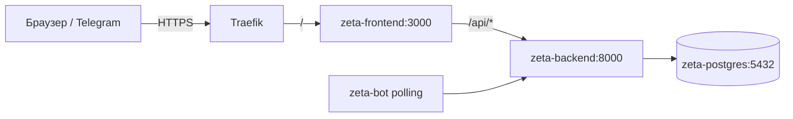

# Деплой в прод (Coolify)

Боевая среда — VPS hostkey.ru (`185.149.146.23`, Ubuntu 24.04) с Coolify 4.7.6 и Traefik.
Приложения собираются из репозитория `Ivansups/Zeta`, ветка `main`.

## Схема



Наружу открыт только frontend. Backend и бот живут во внутренней сети Coolify
(`coolify`), БД наружу не публикуется. Бот работает на long polling — домен и webhook
ему не нужны.

## Ресурсы в проекте Zeta

| Ресурс | Тип | Порт | Домен |
|---|---|---|---|
| `zeta-postgres` | Database → PostgreSQL 17 | — (без public port) | нет |
| `zeta-backend` | Application, Dockerfile, база `/backend` | 8000 | нет |
| `zeta-frontend` | Application, Dockerfile, база `/frontend` | 3000 | `https://<домен>` |
| `zeta-bot` | Application, Dockerfile, база `/telegram-bot` | — | нет |

Контейнеры называем явно (`zeta-backend`, `zeta-frontend`, `zeta-bot`, `zeta-db`):
на этих именах строится внутренний DNS.

## Переменные окружения

`ENVIRONMENT=production` включает проверку секретов: с дефолтными
`JWT_SECRET_KEY`/`TELEGRAM_BOT_TOKEN` или пустым `INTERNAL_API_SECRET` backend
не стартует.

**backend**

```
ENVIRONMENT=production
DATABASE_URL=postgresql+asyncpg://zeta_admin:<пароль>@zeta-db:5432/zeta_prod
TELEGRAM_BOT_TOKEN=<токен из BotFather>
JWT_SECRET_KEY=<64 hex-символа>
INTERNAL_API_SECRET=<64 hex-символа>
ALLOWED_TELEGRAM_USERS=<id или @username через пробел>
LLM_API_KEY=<ключ OpenAI-совместимого API>   # без него /llm/ask не работает
LLM_BASE_URL=https://api.openai.com/v1
LLM_MODEL=gpt-4o-mini
LLM_TIMEOUT=30.0
```

**frontend** — runtime:

```
API_URL=http://zeta-backend:8000
PORT=3000
HOSTNAME=0.0.0.0
```

**frontend** — build-time (в Coolify включить «Build Variable», иначе значения
не попадут в бандл):

```
NEXT_PUBLIC_TELEGRAM_BOT_USERNAME=zeta_hometask_bot
NEXT_PUBLIC_ENABLE_DEV_LOGIN=false
```

**bot**

```
BOT_TOKEN=<тот же токен, что у backend>
BACKEND_BASE_URL=http://zeta-backend:8000
BACKEND_INTERNAL_SECRET=<то же значение, что INTERNAL_API_SECRET>
WEB_APP_URL=https://<домен>
POLLING_TIMEOUT=30
LOG_LEVEL=INFO
DRAFT_TTL_SECONDS=900
QUESTION_THROTTLE_SECONDS=3.0
```

## Порядок первого деплоя

1. Postgres: задать пользователя/пароль/имя БД, включить volume, публичный порт выключить.
2. Backend: healthcheck `GET /health` (порт 8000). Миграции Alembic накатываются
   в `CMD` контейнера до старта uvicorn.
3. Frontend: healthcheck `GET /` (порт 3000), домен + Let's Encrypt.
4. Bot.
5. Проверить, что локальный инстанс бота остановлен — два polling-клиента на одном
   токене конфликтуют (409).

## Смоук-тест

- `http://<домен>` редиректит на `https://`, сертификат валиден.
- `/login` показывает кнопку Telegram-виджета (значит build-переменные дошли).
- Логин одним из `ALLOWED_TELEGRAM_USERS`, запросы к API идут через `/api/*`.
- `/tg-app` открывается внутри Telegram и авторизуется по initData.
- Бот: `/start`, создание черновика ДЗ, вопрос по ДЗ.
- В логах backend нет трейсбеков, контейнеры не в restart loop.

Проверять вход по `http://<IP>` бессмысленно: cookie ставится с `Secure`, логин
работает только по HTTPS.

## После деплоя

- **Первый админ.** Бутстрапа нет, пользователь создаётся со ролью `student`:
  ```sql
  UPDATE users SET role = 'admin', token_version = token_version + 1
  WHERE telegram_id = <id>;
  ```
- BotFather: `/setmenubutton` → `https://<домен>/tg-app`.
- Бэкап БД: ежедневно, retention 7–14 дней, восстановление проверить руками.
- Внешний uptime-монитор на `https://<домен>` (`/health` backend наружу не смотрит).
- Coolify → Notifications → Telegram: включить алерты.
- Откат: Coolify хранит прошлые образы (`Rollback` в приложении).
