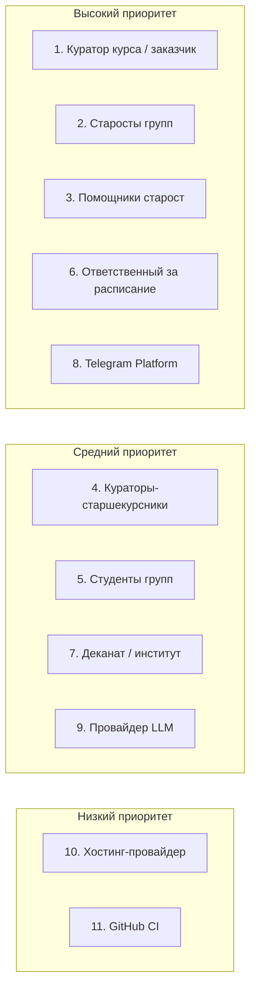
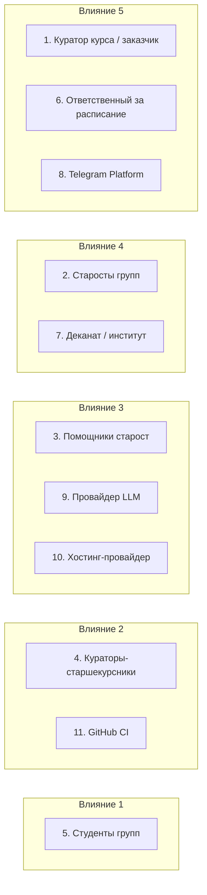
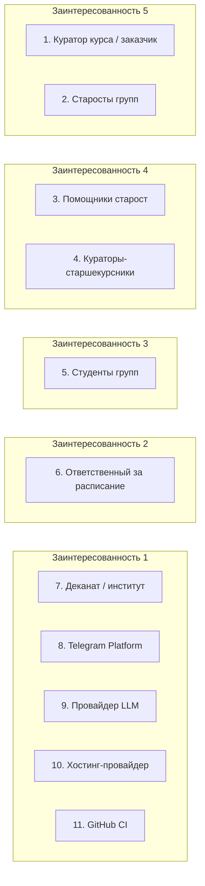

# Реестр заинтересованных сторон

**Фаза:** 1 — команды, легенда, интервью с заказчиком  
**Проект:** Zeta — система учёта домашних заданий и расписания студентов

## Назначение документа

Реестр фиксирует всех лиц и организации, чьи интересы затрагивает проект Zeta, их влияние, ожидания и стратегию взаимодействия. Требование: не менее 5 внешних заинтересованных сторон (отмечены звездочкой ★).

## Основная таблица

| # | ЗС | Категория | Заинт. | Влияние | Приоритет | Ожидания | Стратегия взаимодействия | Следствия (требование / риск / ограничение) |
|---|---|---|---|---|---|---|---|---|
| 1 | Преподаватель практики (куратор курса / приёмка) — он же заказчик | Заказчик | 5 | 5 | Высокий | Полный и своевременный комплект артефактов по каждой фазе и итерации, обоснованные оценки | Демо на парах раз в две недели; любые решения по срокам и объёму — заранее на согласование | Критерии приёмки MVP зафиксированы в [03-устав-проекта.md](03-устав-проекта.md); календарь 4 двухнедельных итераций — жёсткое ограничение |
| 2 | Старосты групп (`elder`) | Пользователь (управление) | 5 | 4 | Высокий | Быстрое создание групп (self-service), понятный ввод ДЗ, генерация инвайт-ссылок для подгрупп, хелперов и кураторов | Вовлечение в приёмочное тестирование (WBS 8.2); сбор обратной связи через бота | Требования к UX формы ДЗ ([../Task.md](../Task.md) §6); риск: низкая активность старост = пустая система |
| 3 | Помощники старост (`helper`) | Пользователь (со-ведение) | 4 | 3 | Высокий | Совместное ведение ДЗ и расписания обеих подгрупп, помощь старосте | Назначение старостой или вход по инвайту помощника | Требования: те же права на CRUD ДЗ и корректировку пар, что и у старосты ([../Task.md](../Task.md) §2) |
| 4 | Кураторы групп со старших курсов (`curator`) | Пользователь (наставничество) | 4 | 2 | Средний | Просмотр расписания/ДЗ подопечной группы, возможность делиться материалами и советами к лабам | Прикрепление по ссылке куратора от старосты; отображение контакта куратора студентам | Взаимопомощь студентов (Peer assistance, [../Task.md](../Task.md) §1, §2); материалы куратора |
| 5 | Студенты (`student`) | Пользователь (чтение) | 3 | 1 | Средний | Актуальные ДЗ к ближайшим парам своей подгруппы, отметки «Выполнено», вход в 1 клик | Информирование через старост и чаты подгрупп при запуске | Требования: разграничение по подгруппам ([../Task.md](../Task.md) §5) и переключение подгруппы; критерий приёмки «студент видит ДЗ своей подгруппы» |
| 6 | Ответственный за публикацию расписания на Яндекс.Диске (методист/диспетчерская) | Внешний источник данных ★ | 2 | 5 | Высокий | — (не в курсе про Zeta) | Мониторинг структуры файла; при смене формата — алерт парсинга + ручная проверка; фоновый воркер | Риск: смена структуры Excel ломает централизованный парсинг ([../Task.md](../Task.md) §4); альтернатива — локальный импорт расписания старостой |
| 7 | Деканат / дирекция института | Регулятор по данным ★ | 1 | 4 | Средний | Система не позиционируется как официальный электронный журнал или официальный источник | Явная оговорка в UI и документации; никаких оценок и посещаемости | Ограничение: «не электронный журнал и не официальный источник» ([../Task.md](../Task.md) §1); персональные данные по 152-ФЗ не собираются |
| 8 | Telegram (платформа, Login Widget, Bot API) | Технологическая зависимость ★ | 1 | 4 | Высокий | Стабильный Login Widget, Mini App SDK и Bot API | Публичный HTTPS-домен (через Cloudflare) для Telegram Login Widget; локальная валидация HMAC без сетевых запросов к TG | Авторизация через Telegram Login Widget ([../Task.md](../Task.md) §3.3); WBS 3.2, 6.2 |
| 9 | Провайдер LLM (GigaChat / OpenRouter, бесплатный тариф) | Технологическая зависимость ★ | 1 | 3 | Средний | — | Ограничение нагрузки; заложить деградацию при исчерпании лимита; парсинг ДЗ, антиспам, ответы бота | Бюджет 0, бесплатные тарифы ([../Task.md](../Task.md) §8); WBS 4.5 «llm» |
| 10 | Хостинг-провайдер | Технологическая зависимость ★ | 1 | 3 | Низкий | Доступность сервера и базы PostgreSQL | Выбор VPS в РФ + Cloudflare проксирование | Развёртывание монорепозитория ([../Task.md](../Task.md) §10) |
| 11 | GitHub (репозиторий, CI) | Инфраструктура ★ | 1 | 2 | Низкий | Публичный репозиторий, стабильный CI | Публичный репозиторий по умолчанию; CI на тесты и алерты | WBS 3.1 «Монорепозиторий и CI» |

**Итог по требованию «≥ 5 внешних сторон»:** отмечено шесть строк (6–11). Преподаватель (заказчик) и пользователи (старосты, хелперы, кураторы, студенты) в это требование не зачитываются.

## Матрица Менделоу (влияние × заинтересованность)

### Пирамида по приоритету

### Пирамида по влиянию (1–5)

### Пирамида по заинтересованности (1–5)

